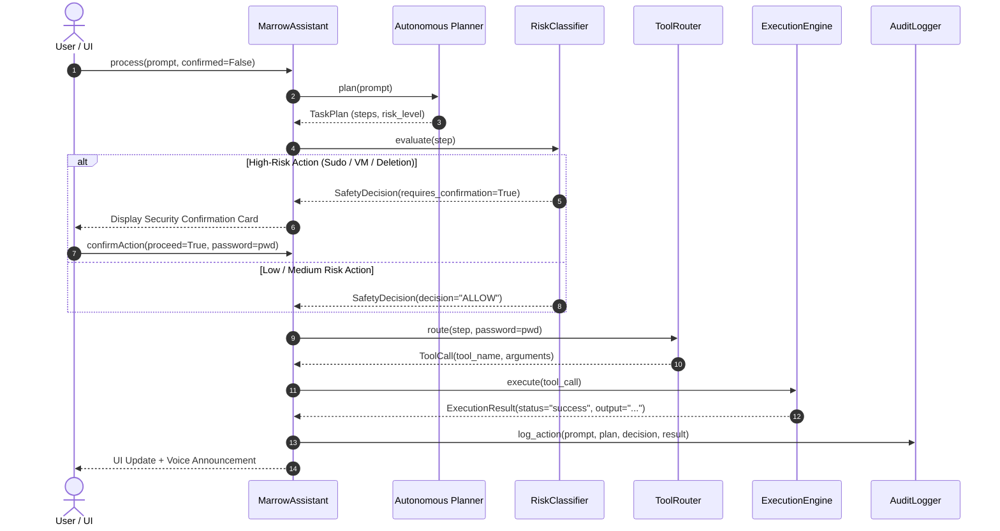
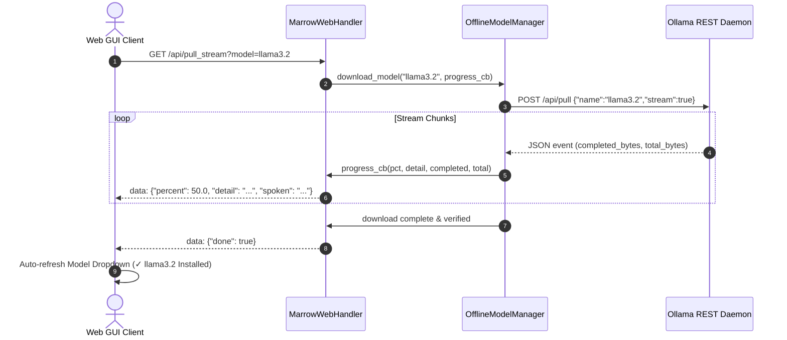

# MarrowAI — System Design Specification (HLD & LLD)

> **Document Status**: Production Ready | **Version**: 2.0.0 | **Author**: MarrowAI Core Engineering Team  
> **References**: [ARCHITECTURE.md](file:///c:/Users/tejas/Projects/MarrowAI/docs/ARCHITECTURE.md), [PRD.md](file:///c:/Users/tejas/Projects/MarrowAI/docs/PRD.md), [INTERFACES.md](file:///c:/Users/tejas/Projects/MarrowAI/docs/INTERFACES.md), [SECURITY.md](file:///c:/Users/tejas/Projects/MarrowAI/docs/SECURITY.md), [FEATURES.md](file:///c:/Users/tejas/Projects/MarrowAI/docs/FEATURES.md), [DECISIONS.md](file:///c:/Users/tejas/Projects/MarrowAI/docs/DECISIONS.md)

---

## 1. Executive Summary & Design Principles

MarrowAI is an autonomous, local-first Linux workstation assistant that understands natural language, decomposes complex tasks into structured plans, evaluates operational risks, and safely executes verified actions on the local operating system.

### Core Architectural Tenets
1. **LLM Outside the Privileged Path**: The Large Language Model (LLM) is treated as an untrusted cognitive reasoning engine. It proposes plans; it never directly executes shell commands or touches kernel boundaries without passing through the safety gate.
2. **Typed Data Contracts**: All inter-module communication uses immutable, typed data classes (`UserInput`, `TaskPlan`, `PlanStep`, `SafetyDecision`, `ExecutionResult`), strictly banning raw shell string emissions.
3. **Zero-Trust Safety Gate**: Every action is evaluated by an independent `RiskClassifier` (`LOW`, `MEDIUM`, `HIGH`). High-risk actions (package installation, VM creation, disk modifications, sudo) halt execution for interactive user authorization.
4. **Proactive Resource Governance**: The `ResourceGovernor` monitors kernel and system telemetry (`/proc/loadavg`, `/proc/meminfo`) independently of the model runtime, proactively throttling or blocking workloads to prevent system exhaustion.
5. **Local-First & Offline Resilience**: Defaults to local execution via Ollama and offline voice synthesis, operating fully without internet connectivity.

---

## 2. High-Level Design (HLD)

The High-Level Architecture organizes MarrowAI into **7 isolated tiers**, ensuring clean boundaries between presentation, cognition, security, and execution.

### Architectural Blueprint (HLD)


> *Rasterized image version: [HLD_SYSTEM_DESIGN.png](file:///c:/Users/tejas/Projects/MarrowAI/docs/HLD_SYSTEM_DESIGN.png)*

### Detailed Layer Breakdown

#### Layer 1: Client & Presentation Layer
- **Web GUI Workstation (`web_gui.py`)**:
  - Ultra-premium dark obsidian interface (`#080A0F`, `#0E131F`, `#141B2D`) with frosted glassmorphic cards (`backdrop-filter: blur(20px)`).
  - Dynamic Model Selector: Automatically queries Ollama on launch and groups models under `✓ Downloaded & Ready` and `Available to Download`.
  - Server-Sent Events (SSE): `/api/pull_stream` delivers real-time model download progress (0% to 100%, MB/s, milestones at 25%, 50%, 75%).
  - Real-time animated speech waveform indicator and auto-listen conversational loop.
- **Tkinter Desktop GUI (`gui.py`)**:
  - `MarrowAIWindow` built on Tkinter's `clam` theme customized with the Dark Obsidian palette.
  - Live telemetry meters displaying CPU load, free memory, and hypervisor detection.
  - Grouped combobox selector prioritizing installed models with `✓ [Installed]` status.
  - Dedicated security audit log modal viewer.
- **CLI & Interactive Shell Suite (`cli.py`, `interactive.py`, `doctor.py`)**:
  - `marrowai`: Single-shot and script-dispatch execution.
  - `marrowai-chat`: Interactive conversational REPL with security prompts.
  - `marrowai-doctor`: Comprehensive diagnostic suite validating environment readiness.
- **Natural Voice Ingest & Audio**:
  - Web Speech API integration in Chrome/Edge with automatic neural voice selection (`Microsoft Neerja Online (Natural)`).
  - Conversational turn-taking: Auto-Listen activates the microphone automatically after the assistant finishes speaking.

#### Layer 2: Multimodal Ingestion & Normalization Layer
- **STT Abstraction (`voice.py`)**:
  - Interfaces with browser speech recognition and local audio chunk ingestion.
- **Input Normalizer & Intent Classifier**:
  - Sanitizes control characters and strips dangerous injection tokens.
  - Classifies user inputs into conversational vs. operating system execution tasks.
- **Session Context Store**:
  - Maintains conversation turn history, active model state, and pending security confirmation cards.

#### Layer 3: Cognitive & Planning Engine
- **`MarrowAssistant` (`assistant.py`)**:
  - Top-level facade coordinating the entire request lifecycle.
- **Autonomous Planner (`planner.py`)**:
  - Decomposes ambiguous human requests into deterministic, sequential `PlanStep` objects.
  - Built-in deterministic mappings for Arch/Ubuntu VM provisioning, project scaffolding, and model lifecycle operations.
- **Model Provider Abstraction (`model.py`)**:
  - `ModelProvider` base class with `OllamaProvider` implementing REST client communication (`/api/tags`, `/api/pull`, `/api/generate`).
  - Automatic endpoint discovery (`discover_ollama_base_url`) detecting local, WSL2 host gateways (`/proc/net/route`), and container runtimes.

#### Layer 4: Zero-Trust Safety, Security & Governance Gateway
- **Risk Classifier (`safety.py`)**:
  - **`LOW`**: Safe reads, telemetry queries, help commands, status checks.
  - **`MEDIUM`**: Workspace scaffolding, file creation, code generation.
  - **`HIGH`**: System package installation, VM provisioning, privileged sudo commands, destructive file operations.
- **Safety Policy Gate**:
  - Evaluates candidate plans against security rules. Rejects prohibited actions (`rm -rf /`, raw disk formatting).
- **Interactive User Authorization Gate**:
  - Halts execution for all `HIGH`-risk actions, surfacing an authorization dialog with password verification.
- **Security Audit Logger (`audit.py`)**:
  - Write-ahead append-only log recording timestamp, prompt, plan, safety decision, tool call, and exit code.
  - Strict secret masking: passwords and credentials are never logged or displayed.

#### Layer 5: Tool Routing & Orchestration Engine
- **Tool Router (`tools.py`)**:
  - Validates tool arguments against strict schemas. Enforces bounded timeouts.
- **Registered Tools**:
  - `VMManager`: Detects hypervisors (`/dev/kvm`, QEMU, VirtualBox), downloads verified ISOs, and provisions headless VMs via cloud-init.
  - `ManageModelsTool`: Pulls, deletes, and lists Ollama models with progress streaming.
  - `ProjectScaffold`: Bootstraps production templates for FastAPI, React, Go, and Rust.
  - `SystemDiagnosticsTool`: Collects CPU, memory, disk, and network interfaces.
  - `GUIAutomationTool`: Accessibility-based fallback (`AT-SPI`, `PyAutoGUI`) strictly invoked only when API and CLI options are exhausted.
- **Execution Engine (`executor.py`)**:
  - Bounded subprocess execution with sandboxed working directories, non-zero exit code capture, and error propagation.

#### Layer 6: Offline Subsystems, Resource Governor & Persistence
- **Offline Model Manager (`model_manager.py`)**:
  - Manages model lifecycle and queries Ollama tags.
  - Preserves models across application reinstalls by storing weights in `~/.ollama/models` (Linux) or `C:\Users\<user>\.ollama\models` (Windows).
- **Resource Governor (`governor.py`)**:
  - Monitors 1m, 5m, 15m load averages and available RAM.
  - Evaluates `is_safe_to_execute()`, proactively protecting the workstation from resource exhaustion.
- **Offline Voice Engine (`voice_engine.py`)**:
  - Multi-tier speech synthesis pipeline:
    1. Microsoft Neural Edge-TTS (Studio-Quality MP3)
    2. Windows SAPI / .NET `SpeechSynthesizer` (Natural voices: `Microsoft Zira`, `Microsoft David`, `Microsoft Heera`)
    3. Linux `espeak-ng` / `spd-say` (Offline fallback)
  - 256-entry in-memory LRU audio cache (`_AUDIO_CACHE`) ensuring sub-5ms replay for repeated prompts.
- **Vector Memory & Storage (`vector_db.py`)**:
  - `SemanticEmbedder`: Zero-dependency, offline feature embedder producing normalized 256-dimensional dense vectors.
  - SQLite binary vector storage with cosine similarity search for local project RAG and context retrieval.

#### Layer 7: Operating System, Kernel & Hypervisor Boundary
- **Operating Systems**: Ubuntu / Debian package distribution (`marrowai.deb`), WSL2, Arch Linux execution target.
- **Kernel Interfaces**: `/proc/loadavg`, `/proc/meminfo`, `/proc/net/route`, cgroups v2 quotas, and eBPF telemetry hooks.
- **Virtualization**: `/dev/kvm` hardware acceleration, QEMU system emulator, VirtualBox headless automation.

---

## 3. Low-Level Design (LLD)

The Low-Level Design defines the concrete **data contracts, class diagrams, method signatures, and interaction sequence diagrams**.

### Architectural Blueprint (LLD)


> *Rasterized image version: [LLD_SYSTEM_DESIGN.png](file:///c:/Users/tejas/Projects/MarrowAI/docs/LLD_SYSTEM_DESIGN.png)*

### 3.1 Data Contracts & Interface Schemas (`interfaces.py`)

```python
@dataclass
class UserInput:
    text: str | None = None
    audio: bytes | None = None
    source: str = "text"  # "text" | "voice"
    metadata: dict[str, Any] = field(default_factory=dict)

@dataclass
class PlanStep:
    id: str
    action_type: str  # "api" | "cli" | "file" | "gui" | "question"
    description: str
    tool_name: str | None = None
    parameters: dict[str, Any] = field(default_factory=dict)
    approval_required: bool = False

@dataclass
class TaskPlan:
    id: str
    intent: str
    steps: list[PlanStep]
    constraints: list[str] = field(default_factory=list)
    risk_level: str = "low"  # "low" | "medium" | "high"

@dataclass
class SafetyDecision:
    decision: str  # "ALLOW" | "REVIEW" | "DENY"
    reason: str
    confidence: float = 1.0
    requires_confirmation: bool = False

@dataclass
class ToolCall:
    tool_name: str
    arguments: dict[str, Any]
    timeout_seconds: int = 30
    resource_profile: str = "standard"

@dataclass
class ExecutionResult:
    status: str  # "success" | "failed" | "blocked" | "partial"
    output: str
    exit_code: int | None = None
    logs: list[str] = field(default_factory=list)
    warnings: list[str] = field(default_factory=list)

@dataclass
class VoiceStatus:
    ok: bool
    engine: str
    message: str
    provider: str
    profile: str = "indian_female"
```

---

### 3.2 Core Component Class Specifications

#### `MarrowAssistant` (`marrowai/assistant.py`)
```python
class MarrowAssistant:
    def __init__(self, model_provider=None, config=None) -> None:
        self.config = config or get_config()
        self.model_provider = model_provider or OllamaProvider(...)
        self.planner = Planner(...)
        self.safety = RiskClassifier(...)
        self.tool_router = ToolRouter(...)
        self.executor = Executor(...)
        self.audit = AuditLogger(...)
        self.governor = ResourceGovernor(...)
        self.voice_engine = OfflineVoiceEngine(...)

    def process(self, prompt: str, confirmed: bool = False, password: str | None = None) -> dict[str, Any]:
        """Processes a user prompt through planning, risk analysis, and execution."""
        ...

    def execute_plan(self, plan: TaskPlan, password: str | None = None) -> dict[str, Any]:
        """Dispatches verified plan steps to the tool router and executor."""
        ...
```

#### `Planner` (`marrowai/planner.py`)
```python
class Planner:
    def plan(self, prompt: str) -> TaskPlan:
        """Decomposes a user prompt into a structured TaskPlan."""
        ...
    def _map_intent(self, prompt: str) -> str: ...
    def _extract_parameters(self, prompt: str) -> dict[str, Any]: ...
    def _map_vm_creation(self, prompt: str) -> TaskPlan: ...
    def _map_model_management(self, prompt: str) -> TaskPlan: ...
```

#### `RiskClassifier` (`marrowai/safety.py`)
```python
class RiskClassifier:
    def evaluate(self, step: PlanStep) -> SafetyDecision:
        """Evaluates whether a PlanStep is safe to execute or requires user review."""
        ...
    def classify_risk(self, action_type: str) -> str: ...
    def is_destructive(self, command_str: str) -> bool: ...
    def requires_sudo(self, step: PlanStep) -> bool: ...
```

#### `OfflineModelManager` (`marrowai/model_manager.py`)
```python
class OfflineModelManager:
    def __init__(self, base_url: str | None = None, model_dir: str | None = None) -> None: ...
    def is_available(self) -> bool: ...
    def download_model(self, model_name: str, progress_callback: Any = None, voice_notify: bool = True) -> tuple[bool, str]: ...
    def list_local_models_detailed(self) -> list[dict[str, Any]]: ...
    def delete_model(self, model_name: str) -> tuple[bool, str]: ...
    def start_service(self) -> tuple[bool, str]: ...
```

#### `OfflineVoiceEngine` (`marrowai/voice_engine.py`)
```python
class OfflineVoiceEngine:
    def synthesize_neural_audio(self, text: str, profile_name: str | None = None) -> bytes | None: ...
    def synthesize_offline_wav(self, text: str, profile_name: str | None = None) -> bytes | None: ...
    def speak(self, text: str, profile_name: str | None = None) -> VoiceStatus: ...
    def set_profile(self, profile_name: str) -> None: ...
    def status(self) -> dict[str, Any]: ...
```

#### `VectorDatabase` & `SemanticEmbedder` (`marrowai/vector_db.py`)
```python
class SemanticEmbedder:
    def encode(self, text: str) -> list[float]:
        """Produces a normalized 256-dimensional semantic dense vector."""
        ...

class VectorDatabase:
    def add_document(self, text: str, metadata: dict[str, Any]) -> str: ...
    def similarity_search(self, query: str, k: int = 5) -> list[dict[str, Any]]: ...
```

---

### 3.3 Sequence Interaction Diagrams

#### 3.3.1 Prompt-to-Execution with Safety Gate Flow


#### 3.3.2 Real-time Model Pull & SSE Streaming Flow


---

## 4. Verification & Testing Matrix

| Component | Test File | Key Invariants Verified |
|:---|:---|:---|
| **Web Server & UI** | [`tests/test_web_gui.py`](file:///c:/Users/tejas/Projects/MarrowAI/tests/test_web_gui.py) | HTML title, Offline Model Manager presence, `/api/models`, `/api/status`, `/api/tts` |
| **Model Lifecycle** | [`tests/test_model_manager.py`](file:///c:/Users/tejas/Projects/MarrowAI/tests/test_model_manager.py) | Offline endpoint error reporting, custom port isolation, model pull/delete |
| **Voice Engine** | [`tests/test_indian_voice.py`](file:///c:/Users/tejas/Projects/MarrowAI/tests/test_indian_voice.py) | Edge-TTS neural audio synthesis, LRU audio cache, natural voice profiles |
| **Safety Gate** | [`tests/test_system_status.py`](file:///c:/Users/tejas/Projects/MarrowAI/tests/test_system_status.py) | TaskPlan intent mapping, tool parameters validation, security confirmation |
| **Resource Governor** | [`tests/test_universal_execution.py`](file:///c:/Users/tejas/Projects/MarrowAI/tests/test_universal_execution.py) | CPU/RAM telemetry collection, execution gating under memory pressure |

---

## 5. Artifact Directory

All visual architectural diagrams generated for this specification are maintained in the [`docs/`](file:///c:/Users/tejas/Projects/MarrowAI/docs/) folder:
- **[HLD_SYSTEM_DESIGN.svg](file:///c:/Users/tejas/Projects/MarrowAI/docs/HLD_SYSTEM_DESIGN.svg)** (Vector High-Level Design)
- **[HLD_SYSTEM_DESIGN.png](file:///c:/Users/tejas/Projects/MarrowAI/docs/HLD_SYSTEM_DESIGN.png)** (Rasterized High-Level Design)
- **[LLD_SYSTEM_DESIGN.svg](file:///c:/Users/tejas/Projects/MarrowAI/docs/LLD_SYSTEM_DESIGN.svg)** (Vector Low-Level Design)
- **[LLD_SYSTEM_DESIGN.png](file:///c:/Users/tejas/Projects/MarrowAI/docs/LLD_SYSTEM_DESIGN.png)** (Rasterized Low-Level Design)
